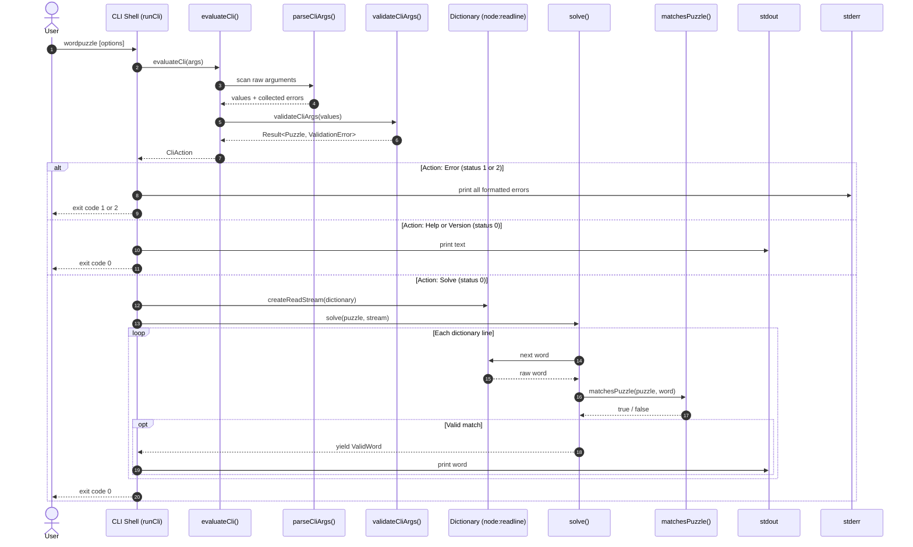
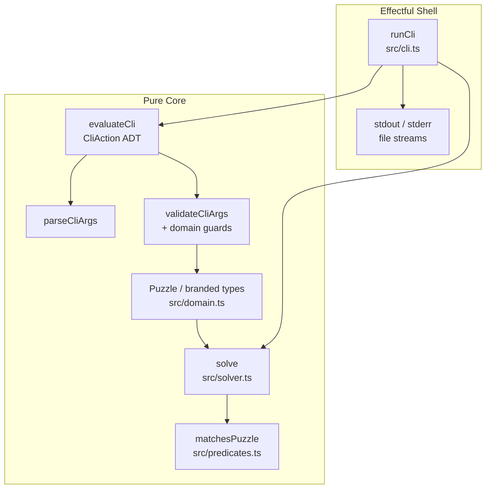

# TypeScript Word Puzzle Solver

Solve 9-letter word puzzles and Spelling Bee word games using modern,
idiomatically typed TypeScript:

- [Nine Letter Word](http://nineletterword.tompaton.com/adevcrsoi/)
- [Your Word Life](http://www.yourwiselife.com.au/games/9-letter-word/)
- [NYT Spelling Bee](https://www.nytimes.com/puzzles/spelling-bee) (using
  `--repeats`)
- [Scientific American Spellements][spellements] (using `--repeats`)

This project is a TypeScript implementation of the canonical Haskell word puzzle
solver available at [haskell-wordpuzzle][haskell-repo].

## Quick Start

### Prerequisites

- Node.js 20.0.0 or later (LTS recommended)
- npm 10.0.0 or later

### Installation

Clone the repository and install dependencies:

```bash
git clone https://github.com/frankhjung/typescript-wordpuzzle.git wordpuzzle
cd wordpuzzle
npm ci
```

### Basic Usage

Run the solver directly using `tsx` or compile and run via Node.js:

```bash
# Show command-line help
npx tsx src/cli.ts --help

# Solve a 9-letter puzzle (letters: cadevrsoi, mandatory: c, min size: 7)
npx tsx src/cli.ts -s 7 -l cadevrsoi

# Solve in Spelling Bee mode with letter repetitions allowed
npx tsx src/cli.ts -s 7 -l mitncao -r
```

Using the `Makefile` convenience wrapper:

```bash
# Run the default sample puzzle
make run
```

## Command-Line Interface

```text
Usage: wordpuzzle [options]

Solve 9-letter word puzzles and Spelling Bee games

Options:
  -s, --size <number>        Minimum word size between 4 and 9 (default: 4)
  -l, --letters <string>     4-9 unique lowercase letters to form words
  -d, --dictionary <path>    Path to dictionary file (default: "dictionary")
  -r, --repeats              Allow letters to repeat (Spelling Bee mode)
  -h, --help                 Display this help message
  -v, --version              Display program version
```

### Validation Rules

Command-line parameters are validated using applicative error accumulation.
Instead of failing on the first error, all violations are reported together:

- **Size:** Must be an integer between 4 and 9 inclusive.
- **Letters:** Must contain between 4 and 9 unique ASCII lowercase letters.
- **Mandatory Letter:** The first letter of `--letters` is designated as the
  mandatory letter that must appear in every match.

### Example Output

Solving the 9-letter puzzle for `cadevrsoi` with minimum size 7:

```text
$ npx tsx src/cli.ts -s 7 -l cadevrsoi
discover
divorce
divorces
sidecar
varicose
viscera
```

### Error Reporting Example

The CLI reports all discovered problems before returning to the user instead of
stopping at the first invalid argument:

```text
$ npx tsx src/cli.ts --invalid -s 2 -l abc
Error: Unexpected argument: Unknown option '--invalid'.
Error: Invalid size '2': size must be an integer between 4 and 9.
Error: Invalid letters 'abc': Letters must contain between 4 and 9 characters.
```

## Dictionary Setup

The default dictionary file is `./dictionary`. A dictionary can be prepared from
the local operating system word list using Make:

```bash
make dictionary
```

This filters `/usr/share/dict/words` to retain only lowercase alphabetic words
with four or more characters, while stripping Roman numerals. Dictionary entries
are processed exactly as they appear in the file; the solver does not normalise
or lowercase them before matching.

## Why This Architecture?

This project follows a strict separation between the effectful shell and the
pure domain core:

- the CLI shell (`runCli`) dispatches actions to streams, manages file I/O, and
  sets exit codes
- the pure domain core (`evaluateCli`, validation, models, and solver)
  evaluates arguments into actions, enforces invariants, and matches candidate
  words

This separation keeps behaviour easy to test, makes validation deterministic,
and avoids mixing business rules with filesystem or terminal concerns.

## Development Workflow

Centralised development tasks are orchestrated via the root `Makefile`:

<!-- prettier-ignore -->
| Target            | Command            | Description                                |
| :---------------- | :----------------- | :----------------------------------------- |
| `make default`    | `format lint ...`  | Format, lint, build, and test              |
| `make help`       | `@awk ...`         | Display available targets and descriptions |
| `make format`     | `npx prettier ...` | Format all tracked source and config files |
| `make lint`       | `npx eslint .`     | Run ESLint static analysis                 |
| `make check`      | `npx tsc --noEmit` | Perform static type checking               |
| `make test`       | `npx vitest run`   | Execute unit and property tests            |
| `make build`      | `npx tsc -p ...`   | Compile TypeScript into `dist/`            |
| `make package`    | `npm pack`         | Package `dist/` into tarball               |
| `make clean`      | `rm -rf dist/ ...` | Remove build and coverage artefacts        |
| `make dictionary` | `grep ...`         | Filter 4+ letter words from dict           |
| `make run`        | `npx tsx ...`      | Execute solver with sample input           |

## Packaging and Distribution

The compiled JavaScript artefacts in `dist/` can be bundled into a standalone
distribution tarball named `wordpuzzle`.

### Creating the Package

Compile the TypeScript source code and package the `dist/` directory using the
`Makefile`:

```bash
make package
```

This target runs `make build` to compile the TypeScript distribution into
`dist/` and runs `npm pack` to generate `wordpuzzle-<version>.tgz` (for example,
`wordpuzzle-0.1.0.tgz`).

Alternatively, build and pack directly using npm:

```bash
npm run build
npm pack
```

### Executing the Package

Once compiled and packaged, the `wordpuzzle` CLI can be executed in several
ways:

1. **Direct execution from `dist/` via Node.js:**

   ```bash
   node dist/cli.js -s 7 -l cadevrsoi
   ```

2. **Via the npm start script:**

   ```bash
   npm start -- -s 7 -l cadevrsoi
   ```

3. **Installation to user's local `~/.local/bin` directory:**

   ```bash
   # Install to ~/.local/bin
   npm install -g --prefix ~/.local ./wordpuzzle-0.1.0.tgz
   wordpuzzle -s 7 -l cadevrsoi
   ```

   _(Ensure `~/.local/bin` is in your shell's `PATH`)._

4. **System-wide global installation:**

   ```bash
   npm install -g ./wordpuzzle-0.1.0.tgz
   wordpuzzle -s 7 -l cadevrsoi
   ```

5. **Local symlink for development:**

   ```bash
   npm link
   wordpuzzle -s 7 -l cadevrsoi
   ```

## Execution Flow

The sequence diagram below illustrates the end-to-end execution flow from
command invocation and pure evaluation to lazy dictionary streaming and
solution output. The evaluator collects both argument-level and domain-level
errors into a pure action before the shell performs effectful reporting.



## Architecture at a Glance

The project separates effectful shell coordination from pure domain logic, which
keeps validation and puzzle matching deterministic and easy to test.



## Project Structure

```text
.
├── src/
│   ├── cli.ts            # command-line shell and pure evaluator
│   ├── domain.ts         # branded types and puzzle domain model
│   ├── validation.ts     # pure validation and error accumulation
│   ├── predicates.ts     # puzzle matching rules
│   ├── solver.ts         # lazy dictionary stream solver
│   └── index.ts          # public exports
├── test/
│   ├── cli.test.ts       # CLI smoke and pure evaluator tests
│   ├── validation.test.ts # validation accumulation tests
│   ├── properties.test.ts # property-based invariants
│   └── ...
├── Makefile               # default build and test orchestration
├── package.json            # Scripts and dependencies
├── README.md              # project overview and usage guide
├── docs/
│   ├── REQ-001-wordpuzzle-specification.md
│   └── REQ-002-pure-cli-action-evaluator.md
└── dictionary             # generated dictionary file (optional)
```

## Specification and Architecture

For comprehensive functional specifications, mathematical models, and property
testing invariants, refer to:

- [REQ-001: Word Puzzle Solver Specification][req-001]
- [REQ-002: Pure CLI Action Evaluator][req-002]
- [GLOSSARY.md](GLOSSARY.md)

[haskell-repo]: https://github.com/frankhjung/haskell-wordpuzzle
[req-001]: docs/REQ-001-wordpuzzle-specification.md
[req-002]: docs/REQ-002-pure-cli-action-evaluator.md
[spellements]: https://www.scientificamerican.com/game/spellements/
