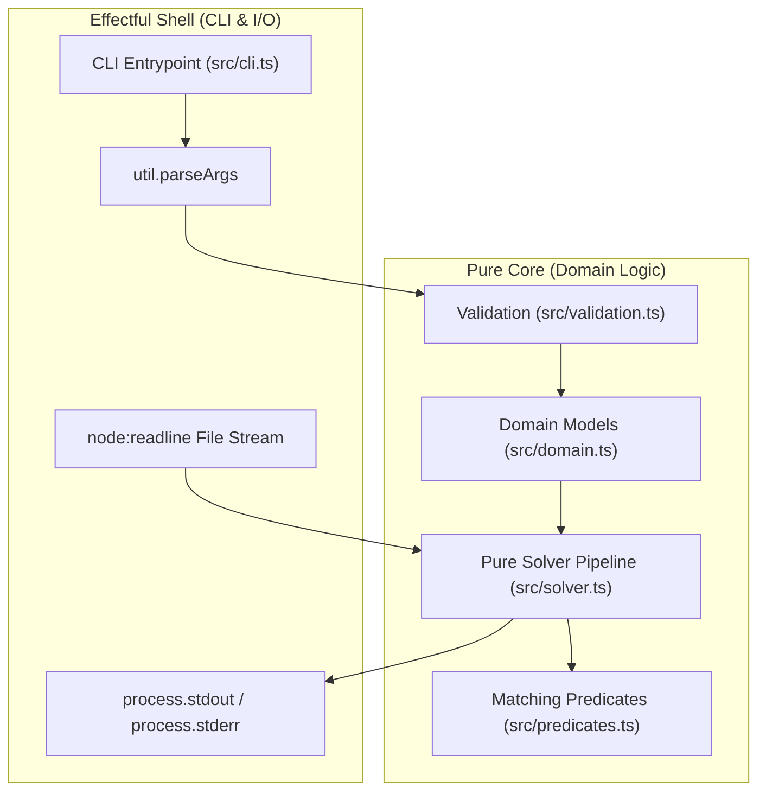

# TypeScript Word Puzzle Solver Specification (REQ-001)

## 1. Overview and Problem Statement

This specification defines the functional requirements, architectural
boundaries, algebraic data models, validation contracts, and verification
strategy for a command-line word puzzle solver written in TypeScript.

The program solves popular newspaper and online word puzzles, including:

- **Nine Letter Word** puzzles (e.g. _The Australian_, _Tom Paton's 9-Letter
  Word_, _Your Word Life_).
- **Spelling Bee** puzzles (e.g. _The New York Times Spelling Bee_, _Scientific
  American Spellements_).

The project serves as the TypeScript implementation of the canonical
Haskell word puzzle solver ([frankhjung/haskell-wordpuzzle][haskell-repo]),
maintaining parity with the existing implementations in Haskell, Lean 4,
Python, Clojure, Kotlin, and Flutter.

The solver reads candidate words from a line-delimited dictionary file and
filters words according to puzzle rules in $O(1)$ constant memory by using
lazy asynchronous line streaming. Each dictionary line is trimmed and then
matched exactly as supplied; the implementation does not normalise or
lowercase entries before applying the puzzle predicates.

## 2. Scope and Non-Goals

### 2.1 In Scope

- **Command-line Interface (CLI):** Zero-dependency CLI built using Node.js
  built-in `node:util` (`parseArgs`), running natively under Node.js 20+ ESM.
- **Applicative Input Validation:** Non-short-circuiting parameter validation
  accumulating all constraint violations into a discriminated `Result` type
  before reporting to `stderr`.
- **Collective Argument Reporting:** The CLI must report all syntax and
  validation errors discovered in the supplied argument list before returning
  to the user; it must not stop at the first invalid flag or missing value.
- **9-Letter Puzzle Mode (Default):**
  - Minimum word length constraint ($4 \le size \le 9$, default: 4).
  - Maximum word length capped at 9 characters.
  - Mandatory letter constraint: word must contain the designated mandatory
    character (first character of the letter pool).
  - Letter frequency constraint: words may only use letters from the pool,
    and each character may appear at most once (no repeated letters).
- **Spelling Bee Mode (`--repeats` / `-r`):**
  - Minimum word length constraint ($size \ge 4$, default: 4).
  - No upper bound on word length.
  - Mandatory letter constraint: word must contain the mandatory character.
  - Letter pool constraint: word may only contain characters present in the
    letter pool, but characters may be repeated without frequency limits.
- **Asynchronous Streaming I/O:** Line-by-line streaming through
  `node:readline` and `AsyncIterable<string>`, processing arbitrary dictionary
  sizes without loading the full file into heap memory.
- **Strict Functional Architecture:** Pure domain core with zero side-effects,
  isolated from the effectful CLI shell (Pure Core, Effectful Shell).
- **QuickCheck-Style Generative Property Testing:** Comprehensive property
  testing with `fast-check` paired with `vitest`.
- **Centralised Build Automation:** GNU Makefile wrapping `help`, `format`,
  `lint`, `check`, `build`, `test`, `clean`, `dictionary`, and `run`.
- **Continuous Integration:** GitHub Actions pipeline verifying formatting,
  linting, strict type checking, unit tests, property tests, and smoke
  execution.

### 2.2 Non-Goals

- Interactive graphical user interfaces or web applications (managed separately
  in the Flutter implementation).
- Network fetching of dictionaries at runtime.
- Destructive dictionary mutation.
- Anagram generation or multi-word phrase anagram solving.

## 3. Mathematical and Domain Model

### 3.1 Input Parameters

The solver accepts four parameters:

1. **`size` ($s \in \mathbb{N}$):** Minimum word length. Must satisfy
   $4 \le s \le 9$. Default is 4.
2. **`letters` ($L \in \Sigma^\*$):** A string of 4 to 9 unique ASCII lowercase
   letters:
   $$ 4 \le |L| \le 9 \quad \land \quad \forall c \in L, c \in [\text{`a'} \dots
   \text{`z'}] \quad \land \quad \text{unique}(L)$$
   $$
3. **`mandatory` ($m \in \Sigma$):** The mandatory character. By convention and
   parity with the Haskell canonical solver, $m$ is implicitly the first
   character of the letter pool:
   $$m = L[0]$$
4. **`repeats` ($r \in \mathbb{B}$):** Boolean flag indicating whether letters
   may repeat (Spelling Bee mode). Default is `false`.
5. **`dictionary` ($d \in \text{FilePath}$):** Path to the dictionary file.
   Default is `"dictionary"`.

### 3.2 9-Letter Word Puzzle Invariants

In default mode ($r = \text{false}$), a dictionary word $w$ is a valid solution
if and only if all four conditions hold:

1. **Length Bounds:**
   $$s \le |w| \le 9$$
2. **Mandatory Inclusion:**
   $$m \in w$$
3. **Alphabet Containment:**
   $$\forall c \in w, \quad c \in L$$
4. **Character Frequency (No Duplicates):**
   $$\forall c \in w, \quad \text{count}(c, w) \le 1$$

Since all characters in $L$ are unique, conditions (3) and (4) are equivalent
to asserting that every character of $w$ belongs to $L$ and $w$ contains no
duplicate characters.

### 3.3 Spelling Bee Invariants

In Spelling Bee mode ($r = \text{true}$), a dictionary word $w$ is a valid
solution if and only if all three conditions hold:

1. **Minimum Length:**
   $$|w| \ge s$$
2. **Mandatory Inclusion:**
   $$m \in w$$
3. **Alphabet Containment:**
   $$\forall c \in w, \quad c \in L$$

There is no upper bound on word length, and characters in $w$ may appear with
arbitrary repetition.

## 4. Pure Core / Effectful Shell Architecture

The codebase adheres strictly to the **Pure Core, Effectful Shell** paradigm:



- **`src/domain.ts`:** Immutable types, branded types, and domain constructors.
- **`src/validation.ts`:** Pure applicative parameter validation returning
  discriminated `Result` values.
- **`src/predicates.ts`:** Pure matching rules with a minimal public matcher
  interface (`matchesPuzzle`) and internal rule composition.
- **`src/solver.ts`:** Pure async generator / transformer filtering an
  `AsyncIterable<string>` of words against a validated `Puzzle`.
- **`src/cli.ts`:** Imperative shell reading arguments, invoking validation,
  opening file streams, writing output lines, and setting exit codes.

## 5. Data Modelling & Strict Type Safety

### 5.1 Branded Nominal Types

To eliminate primitive obsession and prevent invalid strings from entering the
core logic, domain types employ nominal branding:

```typescript
export type WordSize = number & { readonly __brand: unique symbol }
export type LetterPool = string & { readonly __brand: unique symbol }
export type MandatoryChar = string & { readonly __brand: unique symbol }
export type ValidWord = string & { readonly __brand: unique symbol }
```

### 5.2 Discriminated Unions for Puzzle Configuration

The puzzle model uses an immutable, strictly typed representation:

```typescript
export interface Puzzle {
  readonly size: WordSize
  readonly mandatory: MandatoryChar
  readonly letters: LetterPool
  readonly dictionary: string
  readonly repeats: boolean
}
```

### 5.3 Error Handling as Data: Applicative Validation

Errors are modelled explicitly as data values without throwing exceptions:

```typescript
export type ValidationError =
  | {
      readonly type: "invalid_size"
      readonly min: number
      readonly max: number
      readonly actual: number
    }
  | {
      readonly type: "invalid_letters"
      readonly actual: string
      readonly reason: string
    }
  | { readonly type: "missing_letters" }
  | { readonly type: "invalid_puzzle"; readonly detail: string }
  | { readonly type: "unexpected_argument"; readonly detail: string }

export type Result<T, E> =
  | { readonly ok: true; readonly value: T }
  | { readonly ok: false; readonly errors: readonly E[] }
```

Applicative validation evaluates all CLI parameters simultaneously and
accumulates all failures into `Result<Puzzle, ValidationError>`.

## 6. Command-Line Interface (CLI) Contract

### 6.1 Invocation Syntax

```bash
wordpuzzle [-s|--size INT] (-l|--letters STRING)
           [-d|--dictionary PATH] [-r|--repeats]
           [-h|--help] [-v|--version]
```

### 6.2 Options Table

<!-- prettier-ignore -->
| Option | Short | Type | Default | Description |
| :--- | :--- | :--- | :--- | :--- |
| `--size` | `-s` | `number` | `4` | Minimum word size (4–9) |
| `--letters` | `-l` | `string` | *(Req)* | 4–9 unique lowercase letters |
| `--dictionary` | `-d` | `string` | `"dictionary"` | Path to word dictionary |
| `--repeats` | `-r` | `boolean` | `false` | Allow repeated letters |
| `--help` | `-h` | `boolean` | `false` | Display help message and exit |
| `--version` | `-v` | `boolean` | `false` | Display version and exit |

### 6.3 Exit Codes

- `0`: Success (words printed or help/version displayed).
- `1`: Validation error or missing dictionary file.
- `2`: Command-line syntax error (invalid flag).

### 6.4 Error Reporting Policy

The CLI shell must accumulate argument-level and validation-level errors while
walking the full input list. Unknown options, missing option values, positional
arguments, and puzzle validation failures are all normalised into
`ValidationError` records and emitted to `stderr` before the process returns. In
other words, the user sees the complete diagnostic set for the submitted command
instead of a single early failure on the first parse error.

## 7. Function Annotations & TSDoc Standards

All exported functions must include complete TSDoc documentation with:

- Summary description and domain rationale.
- `@param` descriptions with constraints and formats.
- `@returns` description detailing success/failure states.
- `@example` demonstration snippet.
- Purity declaration (referentially transparent pure function).

## 8. Testing & Property-Based Verification

### 8.1 Unit Tests (Vitest)

Unit tests cover:

- Parameter validation accumulation (single and multiple simultaneous errors).
- Predicate behaviour verification through the public `matchesPuzzle`
  contract.
- CLI execution and exit codes via smoke tests.

### 8.2 Generative Property Tests (fast-check)

Generative property tests verify algebraic invariants across 1,000 generated
pseudo-random test cases:

1. **Mandatory Invariant:**
   $$w \in \text{solve}(p, d) \implies p.\text{mandatory} \in w$$
2. **Alphabet Invariant:**
   $$ w \in \text{solve}(p, d) \implies
     \forall c \in w, \; c \in p.\text{letters}$$
   $$
3. **No Duplicates Invariant ($r = \text{false}$):**
   $$w \in \text{solve}(p|_{r=\text{false}}, d) \implies \text{unique}(w)$$
4. **Length Invariant ($r = \text{false}$):**
   $$ w \in \text{solve}(p|_{r=\text{false}}, d) \implies
     p.\text{size} \le |w| \le 9$$
   $$
5. **Length Invariant ($r = \text{true}$):**
   $$ w \in \text{solve}(p|_{r=\text{true}}, d) \implies
     |w| \ge p.\text{size}$$
   $$
6. **Validation Idempotence:**
   $$\text{validate}(\text{serialize}(p)) \equiv \text{Ok}(p)$$

## 9. Build Orchestration, Makefile & CI Automation

### 9.1 Makefile Standard Targets

The root `Makefile` orchestrates development using defensive GNU Make idioms:

- `help`: Self-documenting target descriptions (`make help`).
- `format`: Format source and test files using Prettier
  (`npx prettier --write "src/**/*.ts" "test/**/*.ts" "*.json"`).
- `lint`: Run ESLint static analysis (`npx eslint .`).
- `check`: Type-check without code emission (`npx tsc --noEmit`).
- `build`: Compile TypeScript distribution (`npx tsc -p tsconfig.build.json`).
- `test`: Execute Vitest unit and fast-check property tests (`npx vitest run`).
- `clean`: Remove build outputs and package artefacts
  (`dist/`, `coverage/`, `*.tgz`).
- `dictionary`: Generate filtered 4+ letter words from `/usr/share/dict/words`.
- `run`: Execute solver with sample input (`cadevrsoi`).

### 9.2 GitHub Actions Pipeline

A GitHub Actions workflow (`.github/workflows/build.yml`) runs on push and PR:

1. Installs Node.js 22 and packages via `npm ci`.
2. Verifies formatting (`npx prettier --check .`).
3. Executes static analysis (`npx eslint .`).
4. Verifies types (`npx tsc --noEmit`).
5. Executes full test suite with coverage (`npx vitest run --coverage`).
6. Executes smoke test with example puzzle (`npx tsx src/cli.ts ...`).
7. Compiles production distribution (`npx tsc -p tsconfig.build.json`).

## 10. Architecture Decision Note: Minimal Validation Boundary

**Status:** accepted

The validation boundary exposes a single public entrypoint,
`validateCliArgs`, for converting raw CLI input into `Result<Puzzle,
ValidationError>`. Internal sub-validators remain module-private, and domain
constructor invariant failures are converted into structured
`invalid_puzzle` errors with a stable external message. Validation error
ordering is deterministic (`invalid_size` before `invalid_letters`, then
puzzle-level errors) so diagnostics and tests remain stable.

The CLI parser also enforces a deterministic error-collection policy: raw
argument errors and validation errors are accumulated in sequence and reported
before the process exits, ensuring the user sees all actionable details.

## 11. Architecture Decision Note: Minimal Predicate Interface

**Status:** accepted

The predicate module exposes only `matchesPuzzle` as its public contract.
Rule helpers and mode-specific composition remain internal implementation
details, and the public matcher remains total, non-throwing, and deterministic
with left-to-right short-circuit evaluation.

[haskell-repo]: https://github.com/frankhjung/haskell-wordpuzzle
