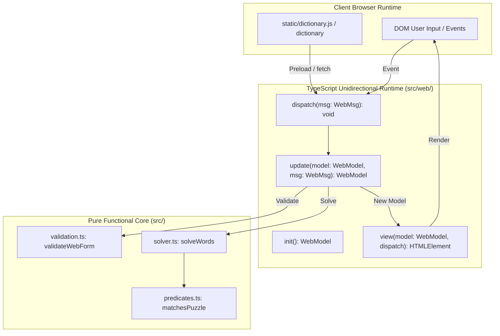

# Web User Interface Specification (REQ-003)

## 1. Overview and Problem Statement

This specification defines the functional requirements, user interface
architecture, state management, static asset pipeline, and verification
strategy for a client-side web version of the TypeScript word puzzle solver.

The web application provides a browser-based user interface matching the visual
design, responsive behaviour, accessibility standards, and domain semantics of
the reference [Elm implementation][elm-repo].

The application runs entirely in client browsers as static assets without any
backend server. The production bundle deploys to GitHub Pages via the existing
GitHub Actions deployment workflow.

## 2. Scope and Non-Goals

### 2.1 In Scope

- **Static Browser Deployment:** Zero-runtime-dependency client-side single-page
  application deployable directly to GitHub Pages.
- **Visual & Structural Parity with Elm Implementation:**
  - Teal / slate modern colour scheme with automatic dark-mode support via CSS
    custom properties.
  - Responsive layout: single column on mobile (< 768 px), split form and
    results panels on desktop (>= 768 px).
  - Explicit input fields: single-character mandatory letter, 3-to-8 character
    other letters pool, optional minimum word size (4 to 9, default: 4), and
    repeat letters toggle (default: true for Spelling Bee mode).
  - Chip-based results display grouped by descending word length with
    alphabetically sorted words, featuring bold teal highlighting for the
    mandatory character within every chip.
- **Unidirectional Architecture (The Elm Architecture):**
  - Pure state model (`WebModel`).
  - Discriminated union of application messages (`WebMsg`).
  - Pure state transition function (`update(model, msg)`).
  - Pure, referentially transparent view rendering functions mapping state to
    DOM nodes with declarative event listeners.
- **Applicative Form Validation:**
  - Non-short-circuiting parameter validation accumulating all violations before
    displaying errors.
  - Dual visual feedback on validation failure: field-level `aria-invalid` and
    error styling on input controls plus an aggregated error summary box.
  - Input sanitisation: lowercase transformation and length truncation on input.
- **Two-Tier Resilient Dictionary Loading:**
  - Primary path: synchronous preloaded dictionary script (`dictionary.js`)
    defining `window.WORDPUZZLE_DICTIONARY` for zero-latency, offline, and
    `file://` execution.
  - Fallback path: asynchronous HTTP `fetch('./dictionary')` with animated
    loading indicator and error recovery banner featuring a retry action.
- **Pure In-Memory Word Grouping:**
  - Filtering candidate words using the pure `matchesPuzzle` predicate from
    `src/predicates.ts`.
  - Grouping matching words by length in descending order, sorting words within
    each group alphabetically.
- **Automated Verification:**
  - Unit tests for web form validation, error accumulation, and word grouping.
  - Generative property tests verifying grouping and ordering invariants with
    `fast-check`.
  - Differential parity tests comparing web solver output directly against the
    CLI solver.

### 2.2 Non-Goals

- Client-side search or live filtering within generated solution chips.
- External dictionary definition lookups (e.g. Wiktionary API links).
- Heavy external UI frameworks (React, Vue, Svelte, Angular); vanilla
  TypeScript with functional DOM generation satisfies all requirements.
- Backend server rendering or server-side state persistence.

## 3. Comparison with Reference Implementations

| Feature       | Haskell CLI        | Elm Web App      | TypeScript Web   |
| :------------ | :----------------- | :--------------- | :--------------- |
| Runtime       | Native binary      | Client (Elm)     | Client (TS)      |
| Architecture  | Pure core / IO     | TEA              | TEA in TS        |
| Mandatory     | Option `-l` char 0 | Separate field   | Separate field   |
| Other letters | Pool string        | 3–8 characters   | 3–8 characters   |
| Word size     | 4–9 (default 4)    | 4–9 (default 4)  | 4–9 (default 4)  |
| Repeats def.  | Off (`false`)      | On (`true`, Bee) | On (`true`, Bee) |
| Validation    | Applicative        | Applicative      | Applicative      |
| Feedback      | Stderr text        | Border + alert   | Border + alert   |
| Solution      | Stream stdout      | Cards by length  | Cards by length  |
| Chip styling  | Terminal text      | Bold mandatory   | Bold mandatory   |
| Dictionary    | File stream        | script + fetch   | script + fetch   |

## 4. Architecture and Unidirectional Data Flow

The web application adopts a functional unidirectional data flow mirroring
The Elm Architecture (TEA):



### 4.1 State Model (`WebModel`)

```typescript
export type DictionaryStatus =
  | { readonly type: "not_asked" }
  | { readonly type: "loading" }
  | { readonly type: "failure"; readonly message: string }
  | { readonly type: "success"; readonly words: readonly string[] }

export interface FormState {
  readonly mandatory: string
  readonly otherLetters: string
  readonly size: string
  readonly repeats: boolean
}

export type SolverOutcome =
  | { readonly type: "not_solved" }
  | { readonly type: "invalid"; readonly errors: readonly ValidationError[] }
  | {
      readonly type: "solved"
      readonly puzzle: Puzzle
      readonly groups: readonly WordGroup[]
    }

export interface WebModel {
  readonly dictionary: DictionaryStatus
  readonly form: FormState
  readonly outcome: SolverOutcome
}
```

### 4.2 Messages (`WebMsg`)

```typescript
export type WebMsg =
  | { readonly type: "got_dictionary_content"; readonly content: string }
  | { readonly type: "got_dictionary_failure"; readonly message: string }
  | { readonly type: "set_mandatory"; readonly raw: string }
  | { readonly type: "set_other_letters"; readonly raw: string }
  | { readonly type: "set_size"; readonly raw: string }
  | { readonly type: "toggle_repeats"; readonly enabled: boolean }
  | { readonly type: "submit" }
  | { readonly type: "retry" }
```

### 4.3 Pure Reducer (`update`)

The `update` function is referentially transparent and completely deterministic:

- `set_mandatory`: Sanitises input to lowercase ASCII and caps length at 1.
  Preserves current `outcome` until the next `submit`.
- `set_other_letters`: Sanitises input to lowercase ASCII and caps length at 8.
  Preserves current `outcome` until the next `submit`.
- `set_size`: Filters non-digits and caps length at 2. Preserves current
  `outcome` until the next `submit`.
- `toggle_repeats`: Flips the boolean repeats flag. Preserves current `outcome`
  until the next `submit`.
- `submit`: Validates the form state. When valid and dictionary is ready,
  computes `solveWords` and updates `outcome` to `solved`. When invalid, sets
  `outcome` to `invalid` with all accumulated errors.
- `retry`: Resets dictionary status to `loading` and triggers dictionary fetch.

## 5. Domain Invariants and Validation

### 5.1 Web Form Applicative Validation

Form inputs are validated applicatively and independently to collect all field
and cross-field errors simultaneously without false-positive cascades:

1. **Mandatory Letter (validated independently):**
   - Must be non-empty (`missing_mandatory`).
   - Must be a single lowercase ASCII character (`invalid_mandatory`).
2. **Other Letters (validated independently):**
   - Must be non-empty (`missing_letters`).
   - Must contain between 3 and 8 characters (`invalid_letters`).
   - Must only contain lowercase ASCII characters (`invalid_letters`).
   - Must not contain duplicate characters (`invalid_letters`).
3. **Cross-Field Disjointness & Combined Pool:**
   - When both `mandatory` and `otherLetters` are valid, `mandatory` must not
     appear in `otherLetters` (`invalid_letters`: "Mandatory letter cannot be
     repeated in other letters").
   - The combined pool `mandatory + otherLetters` satisfies
     $4 \le |letters| \le 9$.
4. **Minimum Word Size (validated independently):**
   - Must parse to an integer satisfying $4 \le size \le 9$ (`invalid_size`).

### 5.2 Word Grouping and Chip Rendering

- Solutions are partitioned by length $L$.
- Length groups are sorted in descending order: $L_1 > L_2 > \dots > L_k$.
- Words within each length group are sorted in ascending alphabetical order:
  $w_1 \le w_2 \le \dots \le w_m$.
- Within every rendered word chip, each occurrence of the mandatory character
  is rendered inside a `<strong class="char-mandatory">` element.

## 6. Static Asset Organisation and Build Pipeline

### 6.1 Directory Layout

All static web assets reside in `static/`, replacing the placeholder root
`index.html`:

```text
.
├── dictionary                  # Canonical Debian wamerican word list (63k)
├── static/
│   ├── index.html              # HTML shell hosting #app mount node
│   ├── style.css               # Responsive stylesheet ported from Elm app
│   ├── favicon.ico             # Favicon asset
│   └── favicon.png             # PNG icon asset
├── scripts/
│   └── generate-dict.js        # Builds static/dictionary.js from dictionary
├── src/
│   ├── domain.ts               # Core nominal types and Result ADT
│   ├── predicates.ts           # Pure matching logic (matchesPuzzle)
│   ├── validation.ts           # Applicative validation functions
│   ├── solver.ts               # Streaming & in-memory word solvers
│   ├── cli.ts                  # CLI runner and action evaluator
│   └── web/
│       ├── model.ts            # Web state types and initial state
│       ├── validation.ts       # Web form applicative validator
│       ├── solver.ts           # Grouping and in-memory solve logic
│       ├── dictionary.ts       # Script preload & fetch loader
│       ├── view.ts             # Functional DOM view renderer
│       └── app.ts              # Browser bootstrap and store wiring
└── dist/                       # Output directory deployed to Pages
    ├── index.html
    ├── style.css
    ├── favicon.ico
    ├── favicon.png
    ├── dictionary
    ├── dictionary.js
    └── web/
        └── app.js
```

### 6.2 Build Targets in Makefile

- `make check`: Type-check CLI, library, and web code with `tsc --noEmit`.
- `make test`: Run Vitest unit, property, and parity suites.
- `make build`:
  1. Executes `make check`.
  2. Generates `static/dictionary.js` via `node scripts/generate-dict.js`.
  3. Compiles TypeScript sources to `dist/`.
  4. Copies `static/*` and `dictionary` into `dist/`.
- `make run`: Executes the CLI sample puzzle (preserving [REQ-001][req-001]
  compatibility).
- `make serve`: Builds the distribution and starts a local HTTP preview server
  on port 8080 via Python 3 (`python3 -m http.server 8080 --directory dist`).
- `make parity`: Verifies web solver output against CLI solver across test
  fixtures.

## 7. Verification and Testing Strategy

1. **Web Form Validation Tests (`test/web-validation.test.ts`):**
   - Valid inputs assemble into valid `Puzzle` configurations.
   - Individual failures (missing mandatory, invalid size, duplicate letters)
     are captured with appropriate error variants.
   - Multiple simultaneous failures accumulate into the error list.
   - Error predicates (`affectsMandatory`, `affectsOtherLetters`, `affectsSize`)
     accurately flag the invalid input controls.
2. **Web Solver Tests (`test/web-solver.test.ts`):**
   - Candidate words are correctly grouped by length in descending order.
   - Words within groups are strictly in alphabetical order.
   - Respects 9-letter constraints (no repeated letters, max length 9).
   - Respects Spelling Bee constraints (letters repeat, no upper limit).
   - Parity test: `solveWords` matches CLI `solve` stream for identical inputs.
3. **Property-Based Invariant Tests (`test/web-properties.test.ts`):**
   - Generative testing with `fast-check` ensuring:
     - Every returned word contains the mandatory letter.
     - Every returned word uses only letters from the pool.
     - Group lengths are strictly monotonically decreasing.
     - Words within groups are strictly monotonically non-decreasing.
4. **Manual Browser Smoke Verification:**
   - Load `dist/index.html` via local HTTP server.
   - Verify initial loading spinner and transition to "Ready to Solve".
   - Enter `c` / `adevrsoi` / `7` / repeats off; verify 6 words found.
   - Enter invalid inputs; verify field border highlights and error banner.
   - Test dark mode styling switch in browser developer tools.

## 8. Documentation Updates

### 8.1 Glossary Revisions (`GLOSSARY.md`)

Update `GLOSSARY.md` to incorporate domain concepts introduced by the web
interface while maintaining strict alphabetical ordering:

- **Other Letters**: Secondary letters completing the letter pool when
  combined with the mandatory letter. In the web interface, this represents
  between 3 and 8 unique lowercase ASCII characters.
  _Avoid_: secondary letters, additional letters
- **Word Chip**: An accessible visual badge representing a solution word in
  the web interface, featuring bold highlighting of the mandatory character.
  _Avoid_: word pill, result tag
- **Word Group**: A collection of solution words sharing an identical character
  length, presented within a dedicated card container sorted in descending
  order of word length.
  _Avoid_: length bucket, length section

### 8.2 README Revisions (`README.md`)

Update `README.md` to document the static web application alongside the CLI:

- Add a **Web Application** section detailing browser usage, local execution
  via `make serve`, and hosting on GitHub Pages.
- Document the two-tier dictionary loading mechanism and offline support.
- Update the **Architecture at a Glance** Mermaid diagram to reflect both the
  CLI effectful shell and the web browser runtime.
- Update the **Project Structure** tree to include `static/`, `scripts/`, and
  `src/web/`.
- Add cross-references to `REQ-003` in the **Specification and Architecture**
  section.

[elm-repo]: https://github.com/frankhjung/elm-wordpuzzle
[req-001]: REQ-001-wordpuzzle-specification.md
